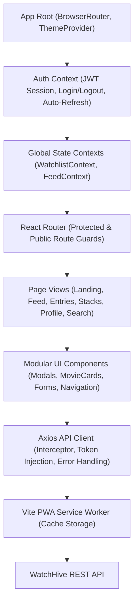

# WatchHive Frontend (Web & PWA) 🍿

> The official web client and Progressive Web App (PWA) for **WatchersHive** — providing an interactive, glassmorphic social experience for movie enthusiasts to discover cinema, curate personal ranking stacks, exchange recommendations, and track watch activity seamlessly online or offline.

---

## 📌 1. What is this Repo For?

WatchHive Frontend is the user-facing web portal for the WatchersHive platform. It gives users a tactile, cinematic interface to:
- **Curate Ranking Stacks**: Build custom, reorderable "movie report cards" that define a user's taste and cinematic journey.
- **Social Movie Recommendations**: Send and receive movie suggestions, see recommendation impact scores, and thank suggesters.
- **Cinematic Watch Logging**: Log ratings, tags, watch dates, and reviews with live TMDb search integration.
- **Activity & Social Discovery**: Follow friends, discover trending movies across the community, and interact via likes and comments.
- **Offline-First PWA Experience**: Installable as a native desktop/mobile app with offline caching and automatic synchronization when reconnected.

---

## 🛠️ 2. Tech Stack

| Layer | Technology | Details |
| :--- | :--- | :--- |
| **Framework** | React 18 | Declarative UI library using functional components and hooks |
| **Language** | TypeScript (v5+) | Static typing across components, contexts, and API schemas |
| **Bundler & Dev Server** | Vite (v5) | Sub-second Hot Module Replacement (HMR) and optimized rollup production bundles |
| **Routing** | React Router v6 | Declarative client-side routing with route guards |
| **Styling & Animation** | Tailwind CSS + Framer Motion | Custom warm honey/cream glassmorphic design system with 60fps animations |
| **HTTP Client** | Axios | Configured client with automatic JWT bearer token interceptors & token refresh |
| **Offline & PWA** | `vite-plugin-pwa` | Workbox-powered service workers, offline asset caching, and manifest setup |
| **End-to-End Testing** | Playwright | Full browser automation and UI testing suite |

---

## 🚀 3. How to Setup

### Prerequisites
- Node.js (v18.x or v20.x+)
- npm (v9+)

### Installation Steps

1. **Clone the repository**:
   ```bash
   git clone https://github.com/dasamantaraoaditya/WatchHive-Frontend.git
   cd WatchHive-Frontend
   ```

2. **Install dependencies**:
   ```bash
   npm install
   ```

3. **Configure Environment Variables**:
   Create a `.env` file in the root directory:
   ```env
   # Backend API Base URL
   # Development: http://localhost:5001
   # Staging: https://watchhive-api-staging.up.railway.app
   # Production: https://watchhive-api-production.up.railway.app
   VITE_API_BASE_URL=http://localhost:5001
   VITE_API_URL=http://localhost:5001/api/v1

   # Google OAuth Client ID (matching Backend)
   VITE_GOOGLE_CLIENT_ID=357857516251-f4gpp8f1j70lu1dcnh405ac0t6lch9tf.apps.googleusercontent.com
   ```

4. **Start Development Server**:
   ```bash
   npm run dev
   ```
   Open `http://localhost:5173` in your browser.

5. **Build for Production**:
   ```bash
   npm run build
   ```
   Outputs the static production bundle to `dist/`.

6. **Preview Production Build**:
   ```bash
   npm run preview
   ```

---

## 🏛️ 4. Architecture

WatchHive Frontend is architected with a strict separation of concerns, ensuring modularity, easy maintenance, and reusable component patterns:



### Directory Structure
```text
src/
├── watchhive/
│   ├── components/       # Reusable modular UI components
│   │   ├── common/       # Buttons, modals, badges, inputs
│   │   ├── entries/      # Watch entry cards, log dialogs
│   │   ├── profile/      # User profile headers, follower sheets
│   │   └── stacks/       # Ranking stack cards, drag-and-drop lists
│   ├── contexts/         # Global state providers (Auth, Watchlist)
│   ├── pages/            # High-level route views
│   │   ├── LandingPage.tsx
│   │   ├── FeedPage.tsx
│   │   ├── EntriesPage.tsx
│   │   ├── ProfilePage.tsx
│   │   └── SearchPage.tsx
│   ├── services/         # Axios API clients (api.ts, tmdb.ts)
│   ├── types/            # TypeScript data contracts & models
│   └── utils/            # Date formatters, image URL helpers
├── App.tsx               # Main application routing & composition
├── main.tsx              # React DOM mounting entry point
└── index.css             # Tailwind base styles and glassmorphic variables
```

---

## ⚡ 5. Performance & Frontend Optimizations

The client-side experience is fine-tuned for high responsiveness, sub-second route transitions, and low bandwidth consumption:

1. **Progressive Web App (PWA) Offline Caching**:
   * **Stale-While-Revalidate**: Applied to static assets, Google Fonts, and UI icons for instantaneous repeat visits.
   * **Network-First with Fallback**: Dynamic feed and watch logs attempt network fetching first, gracefully serving cached data when offline.
2. **Vite Code-Splitting & Tree-Shaking**:
   * Dynamic imports and route-level code splitting keep the initial bundle small, reducing First Contentful Paint (FCP) to under 800ms on broadband.
3. **Optimistic UI Updates**:
   * Interactions such as clicking "Like", bookmarking an entry, or logging a quick watch immediately update the client state before waiting for network confirmation, providing zero-lag feedback.
4. **Poster & Image Optimization**:
   * TMDb poster images use optimized sizing (`w342` / `w500`) instead of raw full-resolution files, saving over 70% in image transfer bandwidth.
5. **Hardware-Accelerated Transitions**:
   * UI modal transitions and drawer sheet animations utilize Framer Motion with CSS `transform` and `opacity` properties, running strictly on GPU composite layers for 60fps smoothness.
